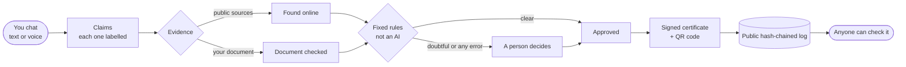
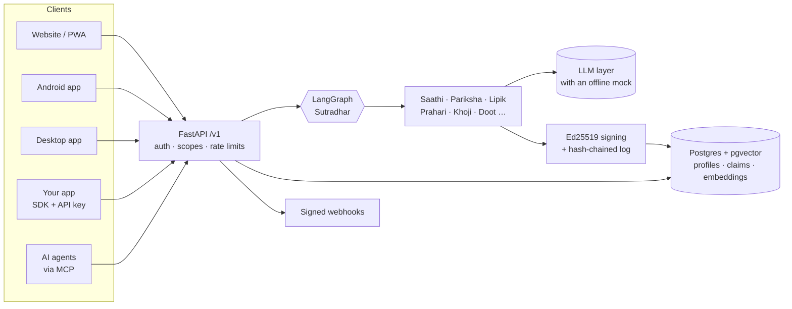

<div align="center">

<br/>

# Pramaan

### *Don't claim it. Prove it.*

**India's verified registry of achievers.**<br/>
Anyone can say they won an award. Pramaan is where the claim comes with proof, and anyone can check it in seconds.

<br/>

[](https://pramaan-rose-chi.vercel.app)
[](backend/tests)
[](docs/adr)

<br/>

<picture>
  <source media="(prefers-color-scheme: dark)" srcset="https://skillicons.dev/icons?i=python,fastapi,postgres,redis,nextjs,react,ts,tailwind,electron,androidstudio,docker,vercel,supabase,githubactions&theme=dark&perline=14">
  
</picture>

</div>

<br/>

---

## Why this exists

Most "who's who" lists are a pile of things people said about themselves. Fake degrees, borrowed awards and padded bios are easy to write and hard to catch.

**Pramaan flips it.** You do not fill in a form and wait. You *talk* to an assistant for a few minutes, and every achievement you mention is checked against evidence. What survives is sealed into a **certificate with a QR code**. Anyone can scan it and see, without trusting us, whether it is genuine and unchanged.

> A certificate you can check is worth more than one you have to trust.

---

## See it in 60 seconds

**[pramaan-rose-chi.vercel.app](https://pramaan-rose-chi.vercel.app)**

| Try this | What you will see |
| --- | --- |
| **Find people**: type *"women scientists in Kerala"* | Plain-language search. No filters to learn, and each result says *why* it matched. Typing in Hindi works too. |
| Open any profile | Each achievement carries a label showing **how it was proven**: self-declared, found in public sources, document checked, or confirmed by a reviewer. |
| **Get listed** | A chat, not a form. Your profile builds on the screen as you talk. Nothing is public until you agree. |
| **Check** a certificate | Scan the QR or paste the code. Five checks run and the verdict comes from the server, never from guesswork. |
| Check an **edited** certificate file | It fails. Change one word in the downloaded certificate and the signature breaks. |

*Demo people on the site are fictional and are labelled "Fictional demo".*

---

## How a claim becomes proof



**Who decides?** Fixed rules, never the AI. The AI helps read documents, suggests wording and finds evidence, but it does not make the final call. Anything doubtful, and every error, goes to a person. Nothing is approved or published because something failed.

**What goes to a person:** anyone without a matching document, award claims, documents that look edited, names that do not match, common names with no second detail, and any edit to an approved profile.

**What is not done yet, on purpose:** we do not check government ID databases (DigiLocker, PAN, Aadhaar). Public evidence comes from Wikipedia and Wikidata, which are crowd-edited, not official registries. The site says so rather than hiding it.

---

## What makes it different

| | Typical registry | **Pramaan** |
| --- | --- | --- |
| How you join | A long form, then a wait | A 3-minute chat |
| What a badge means | "Verified" (by whom?) | Each claim shows **how** it was checked |
| Can you check a certificate? | Trust the page | Scan it. It is signed and written to a public log |
| Can anyone quietly change history? | Possible | Rewriting an entry breaks every later one |
| Who has the final say? | Often an opaque model | Fixed rules, then a person for the doubtful |
| Your data | Kept | Consent first, export and delete any time |

---

## What is in the box

<table>
<tr>
<td width="50%" valign="top">

**For members**
- **Website**: Next.js 15, installable as an app, light and dark
- **Android app**: the same site in a native shell (Capacitor) with a bottom bar and back arrow, like an app and not a shrunken page
- **Desktop app**: Electron, with offline certificate checking and `pramaan://` links

</td>
<td width="50%" valign="top">

**For builders**
- **Public API**: FastAPI, OpenAPI at `/docs`, scoped API keys, rate limits
- **Signed webhooks** with retries and a delivery log
- **SDKs** for Python and TypeScript, an **MCP server** so other AI agents can search and verify, and an **embeddable badge**

</td>
</tr>
<tr>
<td valign="top">

**For the registry team**
- A staff console with a review queue for the doubtful cases
- Role-based access, a tamper-evident audit log, and approvals that need two people for the risky actions

</td>
<td valign="top">

**For trust**
- Ed25519 signatures with published public keys (`/.well-known/pramaan-keys.json`)
- Key-rotation and compromise handling, tested
- Certificates can be re-checked on the device, with nothing uploaded

</td>
</tr>
</table>

### The agents

A team of named AI agents, orchestrated with LangGraph by **Sutradhar**. Each has one narrow job.

| Agent | Job |
| --- | --- |
| **Saathi** | Interviews you, in your own words |
| **Khoji-Pehle** | "Is this you?" discovery from public sources |
| **Pariksha** | Fact-checker. Rejects citations that are not really in the source |
| **Lipik** | Reads uploaded documents and flags forgeries |
| **Prahari** | The auditor. Fixed rules decide, the model only checks the bio |
| **Setu** | Builds the relationship graph (plain code) |
| **Khoji** | Meaning-based search over people |
| **Doot** | Writes invitations in fixed wording, with no model-added links |
| **Chitrakar** | Draws each certificate's artwork (deterministic, plain code) |
| **Shilpkar** | Proposes new features as code, which is only ever run after a guard, a sandbox, tests and a person's approval |

---

## Architecture



---

## Run it yourself

You need Docker. For local development: Python 3.12 with [uv](https://docs.astral.sh/uv/), Node 22+ and pnpm.

### One command

```bash
cp .env.example .env          # add GEMINI_API_KEY, or leave LLM_MODE=mock to run fully offline
docker compose up --build
```

Website <http://localhost:3000> · API docs <http://localhost:8000/docs>

`LLM_MODE=mock` is a deterministic offline mode. The whole product works with no API key, which is handy for demos on bad Wi-Fi.

### For development

```bash
docker compose up -d db                                   # Postgres + pgvector

# API
cd backend
uv venv --python 3.12 && uv pip install -e ".[dev]"
.venv/Scripts/python scripts/seed_demo.py                 # clearly fictional demo profiles (Linux/macOS: .venv/bin/python)
.venv/Scripts/python -m uvicorn app.main:app --port 8000

# Website
cd apps/web
pnpm install && pnpm dev
```

The seed script also creates a demo staff account for local use. **Never deploy with it.** Its details are in `backend/scripts/seed_demo.py`.

### Tests

```bash
cd backend  && .venv/Scripts/python -m pytest -q        # 700+ tests: API, agents, signing, sandbox guard, webhooks (LLM mocked)
cd apps/web && pnpm lint && pnpm build                  # website
cd apps/web && node scripts/smoke-pages.mjs            # browser smoke tests (Playwright), against a running site
cd apps/desktop && pnpm test                            # desktop app and offline verifier
```

---

## Project layout

```text
apps/web        Website (Next.js)            packages/sdk         Python + TypeScript SDKs
apps/admin      Staff console                packages/ui          shared design tokens
apps/mobile     Android shell (Capacitor)    packages/verify-js   offline certificate checker
apps/desktop    Desktop app (Electron)       mcp                  MCP server for AI agents
backend         FastAPI, agents, signing     examples             apps built only on the public API
docs            decisions (adr/), plans, security notes, runbooks
```

---

## Decisions are written down

Why a design is the way it is lives in [`docs/adr`](docs/adr): one page per decision, with the date and the reason.
A few worth reading first:

- **Why not a blockchain?** A blockchain proves a record has not changed since it was written. Certificates already have that (signed, in a hash-chained public log). It cannot show a claim was true when written, so it does not replace evidence.
- **Screens are English only for now** ([ADR 0016](docs/adr/0016-english-only-screens.md)). Typing or speaking Hindi still works; translated screens wait for a native reader's review.
- **Fewer routine reviews** ([ADR 0018](docs/adr/0018-fewer-routine-reviews.md)). A person is not sent every first listing any more. Missing evidence, award claims and anything suspicious still go to one.

---

## Honest notes

- **Demo data is fictional** and labelled. Pre-filled facts come from public sources only, are marked *suggested, unverified*, and never produce a certificate for someone who has not agreed.
- Personal data follows the spirit of India's DPDP Act: an explicit consent ledger, export-my-data and delete-my-data.
- `PLUGINS_ENABLED` and `WEBHOOK_ALLOW_PRIVATE` default to `false` and are for local development only.
- The free hosting the demo runs on sleeps when idle, so the first visit can take a few seconds to wake up.

<div align="center">

<br/>

**Pramaan** · proof, not claims.

</div>
