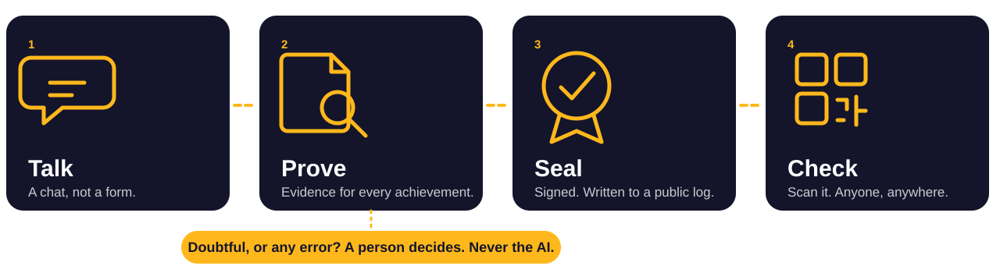
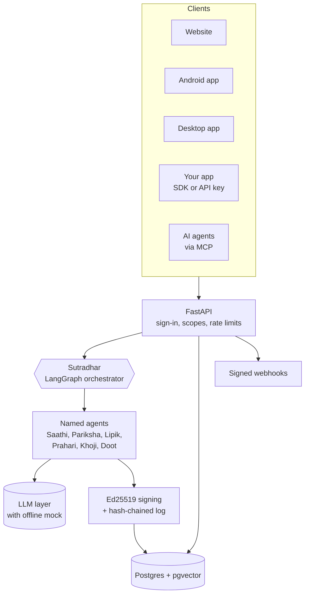

<p align="center">
  
</p>

<p align="center">
  <a href="https://pramaan-rose-chi.vercel.app"></a>
  <a href="backend/tests"></a>
  <a href="docs/adr"></a>
  <a href="docs/adr"></a>
</p>

<br/>

## The problem

Anyone can write *"award-winning"* on a profile. Fake degrees, borrowed honours and padded bios are easy to type and hard to catch, and most "who's who" lists are just a pile of things people said about themselves.

## The idea

**Make the registry itself the proof.** You do not fill in a form and wait for a stranger to approve it. You *talk* to an assistant for a few minutes. Every achievement you mention is checked against evidence and **labelled with how it was proven**. What survives becomes a **signed certificate with a QR code** that anyone can scan, without having to trust us.

<p align="center">
  
</p>

> *A certificate you can check is worth more than one you have to trust.*

<br/>

## Every claim wears a label

No yes-or-no stamp. Each achievement shows **how far it has been proven**, so a visitor can decide what it is worth:

<p align="center">
  
</p>

- **Fixed rules decide, never the AI.** The AI reads documents, suggests wording and finds evidence. It does not make the final call.
- **Anything doubtful, and every error, goes to a person.** Nothing is approved or published because something failed.
- **Honest about the limits.** We do not check government ID databases (DigiLocker, PAN, Aadhaar). Public evidence comes from Wikipedia and Wikidata, which are crowd-edited. The site says so rather than hiding it.

<br/>

## Try it in 60 seconds

**[pramaan-rose-chi.vercel.app](https://pramaan-rose-chi.vercel.app)**

| Do this | See this |
| :-- | :-- |
| **Find people**: type *"women scientists in Kerala"* | Plain-language search with no filters to learn. Each result says *why* it matched. Typing in Hindi works too. |
| Open any profile | Each achievement carries its label: self-declared, public sources, document checked or reviewer confirmed. |
| **Get listed** | A chat, not a form. Your profile builds on screen as you talk. Nothing is public until you agree. |
| **Check** a certificate | Scan the QR or paste the code. Five checks run, and the verdict comes from the server, never from guesswork. |
| Check an **edited** certificate file | It fails. Change one word in the downloaded certificate and the signature breaks. |

<sub>People on the site are fictional demo profiles and are labelled "Fictional demo". The demo runs on free hosting, so the first visit can take a few seconds to wake up.</sub>

<br/>

## Built with

<table align="center">
  <tr>
    <td><b>Backend</b></td>
    <td></td>
    <td>FastAPI, async SQLAlchemy, Postgres with pgvector, LangGraph agents</td>
  </tr>
  <tr>
    <td><b>Web</b></td>
    <td></td>
    <td>Next.js 15, installable as an app, light and dark</td>
  </tr>
  <tr>
    <td><b>Apps</b></td>
    <td></td>
    <td>Android shell (Capacitor) and a desktop app with offline certificate checking</td>
  </tr>
  <tr>
    <td><b>Ship</b></td>
    <td></td>
    <td>Docker, Vercel, Render, Supabase, GitHub Actions</td>
  </tr>
</table>

<br/>

## What is inside

| For | What you get |
| :-- | :-- |
| **Members** | A website (installable), an Android app with a bottom bar and back arrow like a real app, and a desktop app with `pramaan://` links. |
| **Builders** | A public REST API (OpenAPI at `/docs`), scoped API keys, signed webhooks, Python and TypeScript SDKs, an MCP server so other AI agents can search and verify, and an embeddable badge. |
| **The registry team** | A staff console with a review queue for the doubtful cases, role-based access, a tamper-evident audit log, and two-person approval for risky actions. |
| **Trust** | Ed25519 signatures with published keys (`/.well-known/pramaan-keys.json`), a public hash-chained log, tested key rotation, and certificates that can be re-checked on the device with nothing uploaded. |

<details>
<summary><b>Meet the agents</b> (each has one narrow job)</summary>

<br/>

A team of named AI agents, orchestrated with LangGraph by **Sutradhar**.

| Agent | Job |
| :-- | :-- |
| **Saathi** | Interviews you, in your own words |
| **Khoji-Pehle** | "Is this you?" discovery from public sources |
| **Pariksha** | Fact-checker. Rejects citations that are not really in the source |
| **Lipik** | Reads uploaded documents and flags forgeries |
| **Prahari** | The auditor. Fixed rules decide, the model only checks the bio |
| **Setu** | Builds the relationship graph (plain code) |
| **Khoji** | Meaning-based search over people |
| **Doot** | Writes invitations in fixed wording, with no model-added links |
| **Chitrakar** | Draws each certificate's artwork (deterministic, plain code) |
| **Shilpkar** | Proposes new features as code, run only after a guard, a sandbox, tests and a person's approval |

</details>

<details>
<summary><b>Architecture</b></summary>

<br/>



</details>

<br/>

## Run it yourself

You need Docker. For development: Python 3.12 with [uv](https://docs.astral.sh/uv/), Node 22+ and pnpm.

```bash
cp .env.example .env          # add GEMINI_API_KEY, or leave LLM_MODE=mock to run fully offline
docker compose up --build
```

Website <http://localhost:3000> &nbsp;·&nbsp; API docs <http://localhost:8000/docs>

> `LLM_MODE=mock` is a deterministic offline mode. The whole product works with no API key, which is handy for demos on bad Wi-Fi.

<details>
<summary><b>Local development and tests</b></summary>

<br/>

```bash
docker compose up -d db                                   # Postgres + pgvector

# API
cd backend
uv venv --python 3.12 && uv pip install -e ".[dev]"
.venv/Scripts/python scripts/seed_demo.py                 # clearly fictional demo profiles (Linux/macOS: .venv/bin/python)
.venv/Scripts/python -m uvicorn app.main:app --port 8000

# Website
cd apps/web
pnpm install && pnpm dev
```

The seed script also creates a demo staff account for local use. **Never deploy with it.** Its details are in `backend/scripts/seed_demo.py`.

```bash
cd backend  && .venv/Scripts/python -m pytest -q        # 700+ tests: API, agents, signing, sandbox guard, webhooks (LLM mocked)
cd apps/web && pnpm lint && pnpm build                  # website
cd apps/web && node scripts/smoke-pages.mjs            # browser smoke tests (Playwright) against a running site
cd apps/desktop && pnpm test                            # desktop app and offline verifier
```

</details>

<details>
<summary><b>Project layout</b></summary>

<br/>

```text
apps/web        Website (Next.js)            packages/sdk         Python + TypeScript SDKs
apps/admin      Staff console                packages/ui          shared design tokens
apps/mobile     Android shell (Capacitor)    packages/verify-js   offline certificate checker
apps/desktop    Desktop app (Electron)       mcp                  MCP server for AI agents
backend         FastAPI, agents, signing     examples             apps built only on the public API
docs            decisions (adr/), plans, security notes, runbooks
```

</details>

<br/>

## Decisions are written down

Why a design is the way it is lives in [`docs/adr`](docs/adr): one page per decision, with the date and the reason. A few worth reading first:

- **Why not a blockchain?** A blockchain proves a record has not changed since it was written. Certificates already have that: they are signed and sit in a hash-chained public log. A blockchain cannot show a claim was true when it was written, so it does not replace evidence.
- **Screens are English only for now** ([ADR 0016](docs/adr/0016-english-only-screens.md)). Typing or speaking Hindi still works. Translated screens wait for a native reader's review.
- **Fewer routine reviews** ([ADR 0018](docs/adr/0018-fewer-routine-reviews.md)). A person is no longer sent every first listing. Missing evidence, award claims and anything suspicious still go to one.

## Honest notes

- Demo data is fictional and labelled. Pre-filled facts come from public sources only, are marked *suggested, unverified*, and never produce a certificate for someone who has not agreed.
- Personal data follows the spirit of India's DPDP Act: an explicit consent ledger, export-my-data and delete-my-data.
- `PLUGINS_ENABLED` and `WEBHOOK_ALLOW_PRIVATE` default to `false` and are for local development only.

<br/>

<p align="center"><b>Pramaan</b> &nbsp;·&nbsp; proof, not claims.</p>
